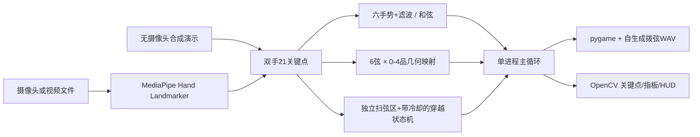

# Air Guitar 实际实现架构（方案 A）

原始用户架构文档**全部保留**，存放于 `docs/original_architecture/`；这一份记录当前实现。

主要目录：`main.py` 组装和运行；`src/camera.py` 摄像头；`src/hand_tracker.py` 识别/模型下载；`src/chord_mapper.py` 手势和去抖；`src/fretboard.py` 6×5 指板坐标；`src/strum_detector.py` 扫弦状态机；`src/audio_engine.py` 非阻塞和弦分解播放；`src/overlay.py` 可视化；`src/demo.py` 合成演示；`src/config.py` 参数；`tests/` 离线自动化测试；`assets/` 45 个原创合成 WAV。

## 五个关键问题的修复

1. **原始四指模板不可稳定识别：**六个有区别的手势 `握拳 / 1 / 2 / 3 / 4 / 张开5指` 选择 `Em / Am / C / D / G / F`；每 5 帧投票且至少 3 票才变化。按 `M` 切换单音模式，采用左手食指在六弦五列中定位。
2. **琴弦与扫弦参考线方向冲突：**琴弦位于左侧水平指板；专门在右侧划出扫弦 ROI，中间设置水平触发线，要求右手食指上下移动穿越该线。触发由法向速度 + 接近状态 + 限时 + 180ms 冷却决定。
3. **和弦发声来源不正确：**和弦模式根据稳定手势对应的预置 MIDI 和弦音列表播放；单音模式仅播放一个 `空弦 MIDI+品位` 音符。
4. **阈值为零：**速度 0.22 像素/毫秒、接近边界 48 像素（按分辨率修正待完善）、冷却 180ms、手势 5 帧窗口；配置集中在 `src/config.py` 可按镜头条件调整；丢帧超时不外推速度。
5. **API 和素材缺失：**新版优先 MediaPipe Tasks Hand Landmarker、旧版 Solutions 在存在时作为回退；45 个合成 WAV 已打包，无版权样本依赖。首次真实摄像头运行如无 `.task` 模型会联网下载，下载失败会给出清晰提示及下载脚本。

## 权限与假设

系统支持 Windows 笔记本摄像头、桌面显示器与音频输出；真实识别质量依赖镜头、光照和 MediaPipe 模型。在无摄像头硬件的构建环境中，仅执行静态检查、离线测试和合成画面烟雾测试，未宣称实机端到端时延与帧率。

## 中文可视化与音乐演奏升级

- `src/overlay.py`：使用 OpenCV 合成视频与互动区，Pillow 加载 Windows 系统中文字体绘制中文 HUD；鼠标命中区域映射为事件。
- `src/song_player.py`：内置《小星星》和《欢乐颂》两个公共领域旋律的节奏事件；伴奏为分解和弦与适当错开扫弦，不阻塞摄像头帧循环。
- `tools/render_song_wav.py`：把音乐事件与原有 Karplus–Strong 模拟拨弦素材混音，导出可直接试听的 WAV。
- `main.py`：保留左右手镜像校正、实时和弦/单音分支；增加 UI 鼠标回调、窗口尺寸适配、自动音乐状态与快捷键。
- 设计隔离：`SongPlayer.update()` 只发出具体 MIDI 音符到 `AudioEngine.note_on()`，运行时视觉识别继续更新；示范曲播放状态下屏蔽现场扫弦的声音（画面不屏蔽）。
