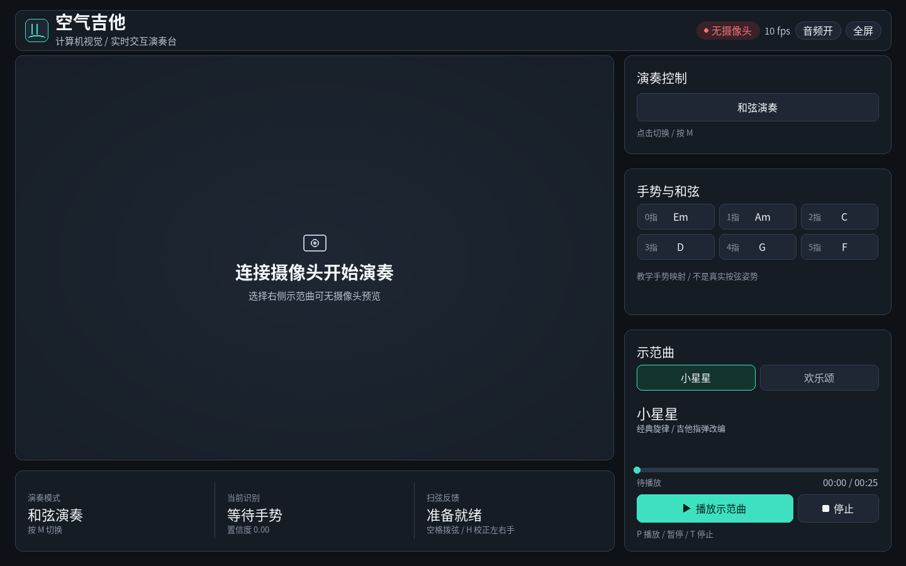
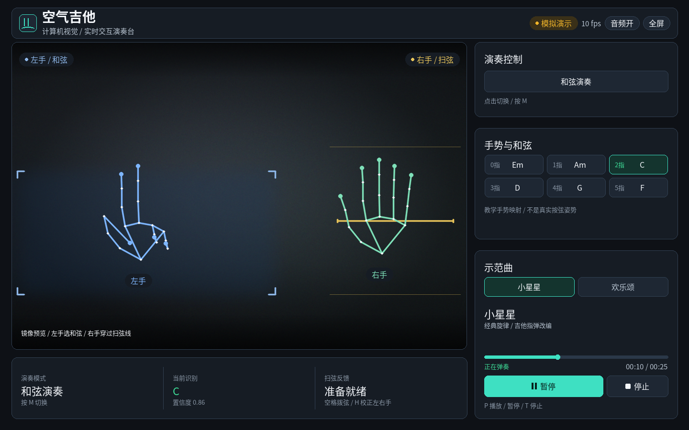
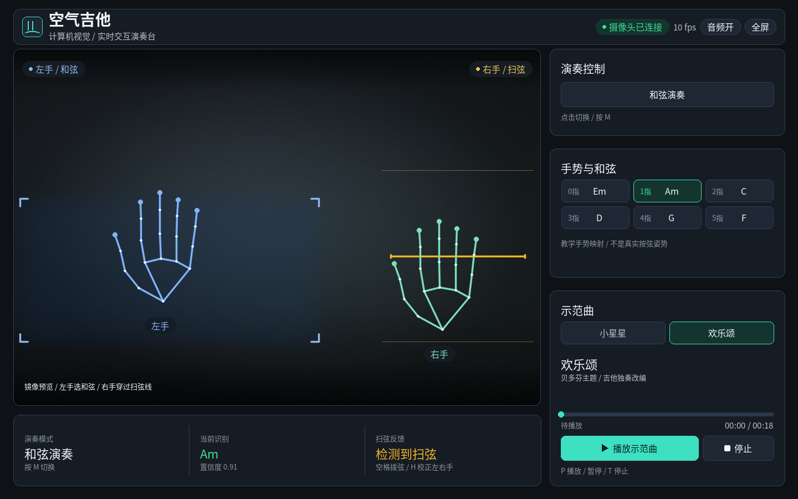

# AirGuitar Vision

空气吉他：MediaPipe + OpenCV 视觉演奏台。左右手分工、中文舞台界面，以及用 Karplus–Strong 拨弦 WAV 编排的示范曲。

Air guitar: a MediaPipe + OpenCV stage. Left-hand chord gestures, right-hand strum, a Chinese stage UI, and demo songs arranged from Karplus–Strong pluck WAVs.

## 中文

### 这是什么

程序用 OpenCV 读取画面，用 MediaPipe 检测双手关键点。左手以伸出的手指数选择和弦（单音模式下用食指指向虚拟指板的弦与品位）。右手食指穿过扫弦线时触发拨弦。音色是项目自带的 Karplus–Strong 合成 WAV（`assets/pluck_40.wav` … `assets/pluck_84.wav`，共 45 个，MIDI 40–84），由 pygame 播放，不是实物吉他录音。

界面是 1440×900 的中文舞台（`src/theme.py` 的 `CANVAS_W` / `CANVAS_H`）。窗口标题为 ASCII：`AirGuitar Vision`。品牌文案是「空气吉他」和「计算机视觉 / 实时交互演奏台」。

示范曲两首，旋律来自公有领域，节奏在程序里按拍调度（播放中不阻塞摄像头循环）：

| 曲目 | 代码 | 时长 |
|---|---|---|
| 小星星 | `twinkle` | 约 26 秒（112 BPM） |
| 欢乐颂 | `ode` | 约 18 秒（104 BPM） |

可单独试听 `assets/demo_song_twinkle.wav` 与 `assets/demo_song_ode.wav`。实时播放器按音符事件调度；`tools/render_song_wav.py` 用来重新导出这两份试听 WAV。示范曲正在播放时，手势扫弦和空格不会再叠一层拨弦声音。

这是象征性的教学手势，不是真实吉他按弦指法。

### 下载

Windows 可执行文件（未签名的 onefile `AirGuitarVision.exe`）：

https://github.com/Logikinet/airguitar-vision/releases/tag/v1.0.1

目标机器不需要安装 Python。首次启动会把资源解到临时目录，可能较慢。

- 未签名。Windows SmartScreen 可能拦截：选择 **更多信息 → 仍要运行**。
- 真实摄像头演奏需要允许桌面应用使用摄像头。Windows 路径与 BUILD.md 相同：**Settings → Privacy & security → Camera → Let desktop apps access your camera**。

### 怎么运行

发布包里的程序：

```text
AirGuitarVision.exe
AirGuitarVision.exe --selftest
```

`--selftest` 检查打包的 WAV、中文界面字体和手部模型，做一次空帧检测后退出。不打开摄像头，也不出声。

从源码在 Windows 上运行：双击 `setup_windows.bat`（优先 `py -3.11`，安装 `requirements.txt`），然后：

- `demo_windows.bat` 或 `python main.py --demo`：合成双手，不需要摄像头，也不需要 MediaPipe 模型。
- `start_windows.bat` 或 `python main.py`：真实摄像头。首次若缺少模型，会下载 Hand Landmarker；也可先运行 `python tools/download_model.py`。
- `python main.py --selftest`：与 exe 相同的离线自检。

其它入口（见 `main.py`）：`--camera N`、`--video 文件`（仍用 MediaPipe）、`--mute`、`--smoke-test`（写 `artifacts/smoke_test.png`）、`--preview`（写 `artifacts/previews/`）。

### 手势

和弦模式数左手伸出的手数，映射在 `src/config.py` 的 `GESTURE_TO_CHORD`。0 是握拳，5 是张开手掌。

| 手数 | 和弦 |
|---|---|
| 0 | Em |
| 1 | Am |
| 2 | C |
| 3 | D |
| 4 | G |
| 5 | F |

镜像画面里，左手放在左侧选和弦，右手放在右侧上下穿过扫弦线。实时摄像头默认交换 MediaPipe 的左右标签（`DEFAULT_HAND_ROLE_SWAP`）。标签反了时按 `H` 校正。`--demo` 和 `--video` 不默认交换；`--demo` 下 `H` 无效。

按 `M` 或点击右侧模式卡片，在和弦与单音之间切换。单音模式显示指板网格，左手食指选择弦与品位。

### 键盘与鼠标

| 键 | 作用 |
|---|---|
| `P` | 播放或暂停当前示范曲 |
| `T` | 停止 |
| `N` | 换到另一首（小星星 ↔ 欢乐颂），并停止 |
| `M` | 和弦 / 单音 |
| `F` | 全屏 / 窗口 |
| `H` | 校正左右手标签（真实摄像头；`--demo` 下无效） |
| `S` | 静音 / 恢复 |
| `D` | 切换调试标志。当前舞台不绘制调试层 |
| 空格 | 有和弦或单音、且示范曲未在播放时，手动拨一次 |
| `1`–`6` | 锁定 Em / Am / C / D / G / F |
| `0` | 取消锁定 |
| `Q` / `Esc` | 退出 |
| `--demo` 下 `A` | 自动循环合成手势 / 固定手势 |
| `--demo` 且单音模式 `I` `K` | 移动弦 |
| `--demo` 且单音模式 `J` `L` | 移动品位 |

右侧卡片可用鼠标点击：模式、小星星、欢乐颂、播放/暂停/继续、停止。顶栏可点音频与全屏。

### 界面截图

下面三张是同一套无头界面绘制（`tools/render_ui_preview.py`），不是摄像头照片。







### 演示视频

[docs/demo.mp4](docs/demo.mp4)

**这是渲染界面演示（Rendered UI demo），不是本机摄像头的实时录像。** 画面由程序绘制的界面帧合成：开头和段落之间是中英文字卡，中间是空摄像头、示范曲进度，以及手势和弦与扫弦。本机没有摄像头参与这支成片。

### 从源码构建

步骤、字体说明和 SmartScreen / 摄像头权限写在 [BUILD.md](BUILD.md)。运行依赖是 [requirements.txt](requirements.txt)（OpenCV contrib、MediaPipe、NumPy、pygame、Pillow、pytest）。打包另需 [requirements-build.txt](requirements-build.txt)（PyInstaller）。`setup_windows.bat` 只安装运行依赖，方便直接跑源码。

回归测试：

```text
python -m pytest -q
```

GitHub Actions 工作流 `build-windows`（`.github/workflows/build-windows.yml`）在 push、pull request 和手动触发时，用 64 位 Python 3.11 安装依赖、跑 pytest、下载手部模型、按 `AirGuitarVision.spec` 打 onefile，并在源码目录外执行 `AirGuitarVision.exe --selftest`。制品名为 `airguitar-vision-windows`。

本地 Windows 构建（与 BUILD.md 相同）：

```powershell
python -m venv .venv
.\.venv\Scripts\Activate.ps1
python -m pip install -r requirements.txt -r requirements-build.txt
python -m pytest -q
python tools/download_model.py
python -m PyInstaller --noconfirm --clean AirGuitarVision.spec
.\dist\AirGuitarVision.exe --selftest
```

打包目标是 Windows 10/11 上的 64 位 Python 3.11。中文界面使用系统字体（微软雅黑、黑体或宋体）；没有这些字体时程序会直接报错，不会下载字体。

## English

### What it is

OpenCV supplies the picture. MediaPipe supplies two-hand landmarks. The left hand picks a chord from how many fingers are raised. In single-note mode the left index finger picks a string and fret on the virtual fretboard. The right index finger plucks by crossing the strum line. Sound is the bundled Karplus–Strong WAVs (`assets/pluck_40.wav` through `assets/pluck_84.wav`, 45 files, MIDI 40–84), played with pygame. They are synthesized plucks, not a recording of a guitar.

The stage is 1440×900 (`CANVAS_W` / `CANVAS_H` in `src/theme.py`). The OpenCV window title is the ASCII string `AirGuitar Vision`. On-stage copy is Chinese: 「空气吉他」 and 「计算机视觉 / 实时交互演奏台」.

Two demo songs use public-domain melodies. Note events are scheduled from the frame clock, so playback does not block the camera loop.

| Song | Key | Length |
|---|---|---|
| 小星星 (Twinkle) | `twinkle` | about 26 seconds (112 BPM) |
| 欢乐颂 (Ode to Joy) | `ode` | about 18 seconds (104 BPM) |

`assets/demo_song_twinkle.wav` and `assets/demo_song_ode.wav` are preview mixes. The live player schedules note events; `tools/render_song_wav.py` rewrites those preview files. While a demo song is playing, gesture strums and the space bar do not add another pluck.

Finger counts are a teaching map. They are not real fretting.

### Download

Unsigned onefile build, `AirGuitarVision.exe`:

https://github.com/Logikinet/airguitar-vision/releases/tag/v1.0.1

Python is not required on the PC that runs the exe. The first launch extracts bundled files to a temp directory and can be slow.

- The executable is unsigned. SmartScreen may block it: choose **More info → Run anyway**.
- Live camera use needs **Settings → Privacy & security → Camera → Let desktop apps access your camera**.

### How to run

From the release:

```text
AirGuitarVision.exe
AirGuitarVision.exe --selftest
```

`--selftest` checks bundled WAVs, the Chinese UI fonts, and the hand model, runs one blank-frame detection, and exits. It does not open a camera or play sound.

From source on Windows, run `setup_windows.bat` (it prefers `py -3.11` and installs `requirements.txt`), then:

- `demo_windows.bat`, or `python main.py --demo`: synthetic hands. No camera and no MediaPipe model.
- `start_windows.bat`, or `python main.py`: the webcam. If the Hand Landmarker file is missing, the first live run downloads it. `python tools/download_model.py` downloads it ahead of time.
- `python main.py --selftest`: the same offline check as the exe.

Other `main.py` flags: `--camera N`, `--video FILE` (MediaPipe on that file), `--mute`, `--smoke-test` (writes `artifacts/smoke_test.png`), `--preview` (writes `artifacts/previews/`).

### Gestures

Chord mode counts raised fingers on the left hand. The map is `GESTURE_TO_CHORD` in `src/config.py`. 0 is a fist. 5 is an open palm.

| Fingers | Chord |
|---|---|
| 0 | Em |
| 1 | Am |
| 2 | C |
| 3 | D |
| 4 | G |
| 5 | F |

In the mirrored picture the left hand stays on the left and chooses the chord. The right hand stays on the right and crosses the strum line. The live webcam swaps MediaPipe’s left/right labels by default (`DEFAULT_HAND_ROLE_SWAP`). Press `H` if a camera labels them the other way. `--demo` and `--video` do not swap by default, and `H` does nothing under `--demo`.

`M`, or the mode card, switches between chord mode and single-note mode. Single-note mode draws the fretboard grid.

### Keyboard and mouse

| Key | Action |
|---|---|
| `P` | Play or pause the current demo song |
| `T` | Stop |
| `N` | Select the other song (Twinkle ↔ Ode to Joy) and stop |
| `M` | Chord / single note |
| `F` | Full screen / window |
| `H` | Swap left/right labels on a real camera. Ignored under `--demo` |
| `S` | Mute / unmute |
| `D` | Toggle the debug flag. The stage does not paint a debug layer |
| Space | One manual strum when a chord or note is active and the demo song is not playing |
| `1`–`6` | Lock Em / Am / C / D / G / F |
| `0` | Clear the lock |
| `Q` / `Esc` | Quit |
| `A` under `--demo` | Cycle synthetic gestures automatically, or hold one gesture |
| `I` / `K` under `--demo`, single-note mode | Move the string |
| `J` / `L` under `--demo`, single-note mode | Move the fret |

The right-hand cards take clicks: mode, 小星星, 欢乐颂, play/pause/resume, stop. The header audio and full-screen pills are clickable too.

### Screenshots

These three frames are drawn by the headless UI renderer (`tools/render_ui_preview.py`). They are not webcam photos.


### Demo video

[docs/demo.mp4](docs/demo.mp4)

**This is a rendered UI demo, not a live webcam recording.** The file is encoded from frames the program drew: bilingual caption cards, the empty-camera stage, a demo song with a moving progress bar, and a gesture chord with a strum. No camera on this machine was used to make it.

### Build from source

[BUILD.md](BUILD.md) has the Windows exe steps, the font note, and the SmartScreen and camera prompts. Runtime dependencies are in [requirements.txt](requirements.txt) (OpenCV contrib, MediaPipe, NumPy, pygame, Pillow, pytest). The package build also needs [requirements-build.txt](requirements-build.txt) (PyInstaller). `setup_windows.bat` installs the runtime requirements only, so the source app can run.

Tests:

```text
python -m pytest -q
```

The GitHub Actions workflow `build-windows` (`.github/workflows/build-windows.yml`) runs on push, pull request, and manual dispatch. It uses 64-bit Python 3.11, installs dependencies, runs pytest, downloads the hand model, builds `AirGuitarVision.spec` as a onefile exe, and runs `AirGuitarVision.exe --selftest` outside the source tree. The artifact name is `airguitar-vision-windows`.

Local Windows build, same commands as BUILD.md:

```powershell
python -m venv .venv
.\.venv\Scripts\Activate.ps1
python -m pip install -r requirements.txt -r requirements-build.txt
python -m pytest -q
python tools/download_model.py
python -m PyInstaller --noconfirm --clean AirGuitarVision.spec
.\dist\AirGuitarVision.exe --selftest
```

The packaging target is 64-bit Python 3.11 on Windows 10 or 11. The Chinese UI uses a system font (Microsoft YaHei, SimHei, or SimSun). If none of those faces is installed, the program raises instead of downloading a font.
