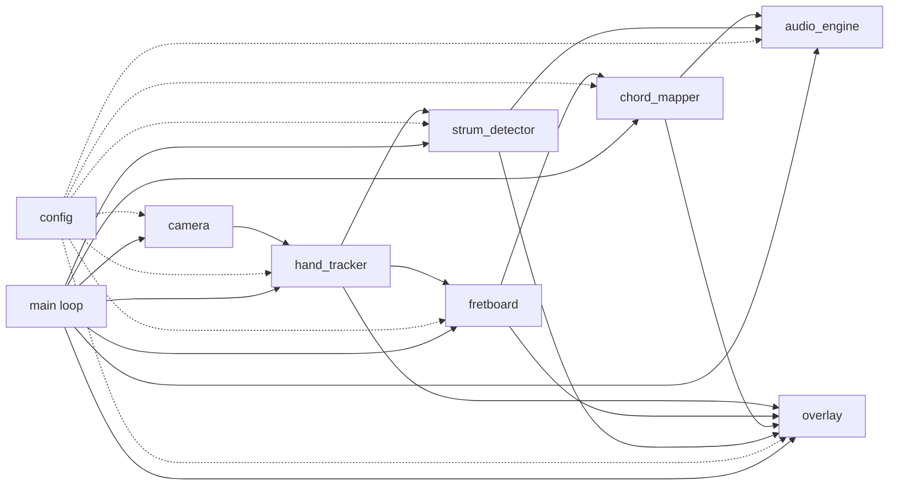
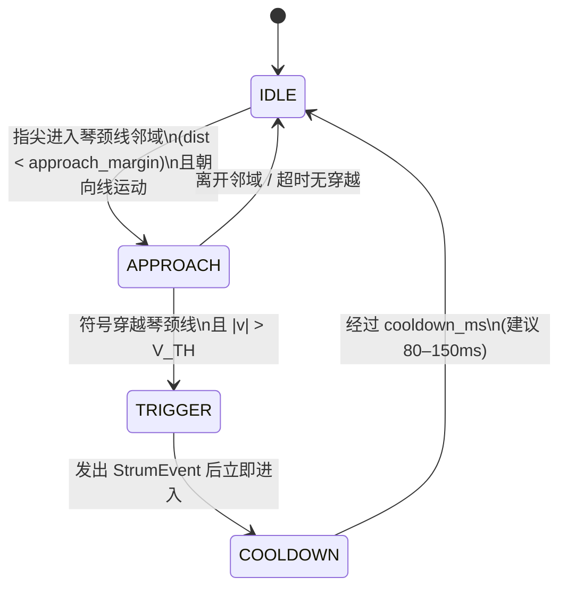

# 空气吉他交互系统 — 课程设计架构文档

> 题目：基于手部关键点的空气吉他交互系统  
> 英文：Air Guitar Interaction System Based on Hand Landmark Detection  
> 性质：本科计算机课设（CV / HCI），**仅架构与思路，不含实现代码**  
> 配套：`COURSE_PLAN.md`（任务书）· `HANDOFF_FOR_CLAUDE.md`（可粘贴提示词）· `ONE_PAGER.md`（一页摘要）

---

## 1. 目标与边界

### 1.1 一句话目标

笔记本摄像头实时识别双手 → 左手决定弦/品位或和弦 → 右手扫弦触发发声 → 画面叠加虚拟 6 弦琴颈与 HUD，形成可演示的闭环空气吉他 Demo。

### 1.2 成功标准（验收）

| 维度 | 合格 | 优秀 |
|---|---|---|
| 帧率 | ≥15 FPS | ≥25 FPS |
| 端到端延时 | <200 ms | <120 ms |
| 和弦 | 静止时基本不乱跳 | 多数投票后稳定 |
| 扫弦 | 静止手不响 | 小幅晃动不响 |
| 演示 | 能弹 Am–C–G–Em 片段 | 有力度 + 模式切换 |

### 1.3 明确不做（Out of Scope）

- 不训练 / 不微调自定义手部检测模型  
- 不做真实吉他琴颈 / 品格视觉识别（ArUco 真琴方案仅可写「未来工作」）  
- 不做完整调音教学 App、账号、云端、社交分享  
- 第一期不做手机 App / Electron / Web 前端（鸿蒙推流仅 Could）  
- **本仓库文档包本身不提供可运行产品实现**；实现由接手方按 `HANDOFF_FOR_CLAUDE.md` 自行生成

---

## 2. 功能范围（MoSCoW）

### Must（验收必过）

1. 实时摄像头预览（可用 ≥15 FPS，目标 ≥20 FPS）  
2. MediaPipe Hands 双手检测与关键点绘制  
3. 虚拟琴颈：固定 ROI 或双手腕定义 **6 弦 × N 品位**（建议 N=4 或 5）  
4. 左手：指尖落入网格 → `(string_id, fret_id)` 或映射为预定义和弦  
5. 右手：扫弦检测（穿线 + 速度阈值）→ 触发一次发声  
6. 发声：至少 6 根空弦音 + 若干和弦（MIDI / pygame / simpleaudio / FluidSynth 任选）  
7. HUD：弦名、当前和弦名、扫弦提示  
8. `q` / `Esc` 退出；可开关调试叠加层  

### Should（报告加分）

1. 时序滤波：连续 K 帧一致才切换和弦  
2. 扫弦力度 → 音量  
3. 单音模式 / 和弦模式快捷键切换  
4. 简单评测：日志或离线视频统计误触发  

### Could（时间够再做）

1. 简谱 / 和弦进行跟练  
2. 录制回放（关键点序列 + 音频时间戳）  
3. 鸿蒙 / 手机推流作摄像头源  

---

## 3. 模块总览（Mermaid）



数据主路径（单帧）：

```
Frame → Hands → Landmarks
              ├→ Fretboard.geometry → (string, fret) / chord_id
              ├→ StrumDetector → strum_event?
              └→ Overlay 绘制
                        ↓
              AudioEngine.note_on / chord_on（仅当 strum_event）
```

---

## 4. 模块职责

| 模块 | 文件建议 | 职责 | 不负责 |
|---|---|---|---|
| `camera` | `src/camera.py` | 打开摄像头、设分辨率/FPS、读帧、释放 | 检测、绘制 |
| `hand_tracker` | `src/hand_tracker.py` | MediaPipe Hands 封装；输出左右手 21 点 + 可见性 | 琴颈几何、音频 |
| `fretboard` | `src/fretboard.py` | 琴颈 ROI / 腕连线几何；6×N 网格；点→(s,f) | 和弦命名、扫弦 |
| `chord_mapper` | `src/chord_mapper.py` | 指型向量 ↔ 模板最近邻；单音/和弦模式；帧滤波 | 发声、穿线检测 |
| `strum_detector` | `src/strum_detector.py` | 右手指尖相对琴颈线的状态机；冷却；力度 | 选和弦、播音频 |
| `audio_engine` | `src/audio_engine.py` | 加载音色/MIDI；`note_on`/`chord_on`/`all_notes_off` | 视觉逻辑 |
| `overlay` | `src/overlay.py` | 画网格、骨架、HUD、调试层 | 业务决策 |
| `config` | `src/config.py` | 阈值、网格、快捷键、路径常量 | 运行时副作用 |
| `main` | `main.py` | 组装模块；主循环；按键；退出 | 算法细节 |

推荐目录（供接手方落地，本文不实现）：

```
air-guitar/
  README.md
  requirements.txt
  main.py
  src/
    camera.py
    hand_tracker.py
    fretboard.py
    chord_mapper.py
    strum_detector.py
    audio_engine.py
    overlay.py
    config.py
  assets/          # wav / sf2（可选）
  tests/           # 几何与状态机单测（可不接摄像头）
  docs/
    design.md
    demo_script.md
```

---

## 5. 公共 API 签名（Python 风格，架构级）

> 以下为接口契约；实现方可微调参数名，但职责边界应保持。

```python
# --- camera.py ---
class Camera:
    def __init__(self, device_id: int, width: int, height: int, fps: int) -> None: ...
    def read(self) -> tuple[bool, "np.ndarray | None"]: ...
    def release(self) -> None: ...

# --- hand_tracker.py ---
@dataclass
class HandResult:
    handedness: str                    # "Left" | "Right"
    landmarks: list[tuple[float, float, float]]  # 21 x (x,y,z) 归一化或像素，约定写清
    score: float

class HandTracker:
    def __init__(self, max_num_hands: int = 2, model_complexity: int = 0) -> None: ...
    def process(self, frame_bgr: "np.ndarray") -> list[HandResult]: ...
    def close(self) -> None: ...

# --- fretboard.py ---
@dataclass
class FretboardGeom:
    origin: tuple[float, float]        # 琴颈左上/近头端
    axis_u: tuple[float, float]        # 沿品位方向单位向量
    axis_v: tuple[float, float]        # 沿弦方向单位向量
    n_strings: int                     # = 6
    n_frets: int                       # = 4 或 5
    string_spacing: float
    fret_spacing: float

class Fretboard:
    def __init__(self, mode: str = "fixed_roi") -> None: ...
    def update(self, hands: list[HandResult], frame_shape: tuple[int, int]) -> FretboardGeom: ...
    def point_to_cell(self, xy: tuple[float, float], geom: FretboardGeom) -> tuple[int, int] | None:
        """返回 (string_id 0..5, fret_id 0..N) 或 None（落在网格外）"""
    def neck_line(self, geom: FretboardGeom) -> tuple[tuple[float, float], tuple[float, float]]:
        """扫弦参考线：两端点（画面坐标）"""
    def draw_guide(self, frame: "np.ndarray", geom: FretboardGeom) -> None: ...

# --- chord_mapper.py ---
ChordId = str  # "Am"|"C"|"D"|"Em"|"G"|"F"|...

class ChordMapper:
    def __init__(self, templates: dict[ChordId, "FingerShape"], vote_window: int = 5) -> None: ...
    def fingertips_to_shape(
        self, left_hand: HandResult, geom: FretboardGeom, fretboard: Fretboard
    ) -> "FingerShape":
        """取食/中/无/小指尖 → 每指 (string, fret) 或 mute"""
    def match(self, shape: "FingerShape") -> tuple[ChordId | None, float]:
        """最近邻 / 汉明距离；返回 (chord_id, confidence)"""
    def update_filtered(self, chord: ChordId | None) -> ChordId | None:
        """多数投票 / 滞回后的稳定和弦"""
    def cells_to_notes(self, cells: list[tuple[int, int]], mode: str) -> list[int]:
        """mode: 'single'|'chord' → MIDI note numbers"""

# --- strum_detector.py ---
class StrumState(Enum):
    IDLE = "IDLE"
    APPROACH = "APPROACH"
    TRIGGER = "TRIGGER"
    COOLDOWN = "COOLDOWN"

@dataclass
class StrumEvent:
    direction: str          # "down" | "up"
    velocity: float         # 穿线瞬间速度幅值
    timestamp_ms: int

class StrumDetector:
    def __init__(self, v_th: float, cooldown_ms: int, approach_margin: float) -> None: ...
    def update(
        self,
        tip_xy: tuple[float, float] | None,
        tip_vel: tuple[float, float] | None,
        neck_line: tuple[tuple[float, float], tuple[float, float]],
        now_ms: int,
    ) -> StrumEvent | None: ...
    @property
    def state(self) -> StrumState: ...

# --- audio_engine.py ---
class AudioEngine:
    def __init__(self, backend: str = "pygame", asset_dir: str = "assets") -> None: ...
    def note_on(self, midi_note: int, velocity: float = 0.8) -> None: ...
    def chord_on(self, midi_notes: list[int], velocity: float = 0.8) -> None: ...
    def all_notes_off(self) -> None: ...
    def close(self) -> None: ...

# --- overlay.py ---
class Overlay:
    def draw(
        self,
        frame: "np.ndarray",
        hands: list[HandResult],
        geom: FretboardGeom,
        chord: ChordId | None,
        strum_state: StrumState,
        debug: bool,
    ) -> "np.ndarray": ...

# --- config.py ---
# 见第 9 节「配置旋钮」；以 dataclass 或常量模块导出。
```

---

## 6. 主循环伪代码

```
init Camera, HandTracker, Fretboard, ChordMapper, StrumDetector, AudioEngine, Overlay
mode ← "chord"          # or "single"
debug ← True
prev_tip ← None
clock ← monotonic_ms()

while True:
    ok, frame ← Camera.read()
    if not ok: break
    now ← monotonic_ms()

    hands ← HandTracker.process(frame)
    left  ← pick_hand(hands, "Left")
    right ← pick_hand(hands, "Right")

    geom ← Fretboard.update(hands, frame.shape)
    neck ← Fretboard.neck_line(geom)

    # --- 左手：和弦 / 品位 ---
    stable_chord ← None
    active_notes ← []
    if left is not None:
        shape ← ChordMapper.fingertips_to_shape(left, geom, Fretboard)
        raw_chord, conf ← ChordMapper.match(shape)
        stable_chord ← ChordMapper.update_filtered(raw_chord)
        if mode == "chord":
            active_notes ← ChordMapper.cells_to_notes(shape.cells, "chord")
        else:
            active_notes ← ChordMapper.cells_to_notes(shape.cells, "single")

    # --- 右手：扫弦 ---
    tip ← index_fingertip(right) if right else None
    vel ← (tip - prev_tip) / dt  if tip and prev_tip else None
    event ← StrumDetector.update(tip, vel, neck, now)
    prev_tip ← tip

    if event is not None and active_notes:
        vel_audio ← map_velocity(event.velocity)   # Should：力度→音量
        if mode == "chord":
            AudioEngine.chord_on(active_notes, vel_audio)
        else:
            for n in active_notes: AudioEngine.note_on(n, vel_audio)

    frame ← Overlay.draw(frame, hands, geom, stable_chord, StrumDetector.state, debug)
    imshow("AirGuitar", frame)

    key ← waitKey(1)
    if key in (q, Esc): break
    if key == 'd': debug ← not debug
    if key == 'm': mode ← toggle(mode)
    if key == 's': AudioEngine.all_notes_off()

release all
```

---

## 7. 扫弦状态机

### 7.1 状态与转移



### 7.2 转移条件（实现时必须可测）

| 当前 | 事件/条件 | 下一状态 | 副作用 |
|---|---|---|---|
| IDLE | `signed_dist(tip, neck)` 进入 `(-m, +m)` 且 `dot(v, normal)` 朝向线 | APPROACH | 记录 `side0 = sign(dist)` |
| APPROACH | `sign(dist) != side0`（穿越）且 `\|v\| > V_TH` | TRIGGER | 构造 `StrumEvent` |
| APPROACH | 离开邻域或停留 > `approach_timeout_ms` | IDLE | 清除 `side0` |
| TRIGGER | （瞬时） | COOLDOWN | 回调上层发声；记 `t_trigger` |
| COOLDOWN | `now - t_trigger >= cooldown_ms` | IDLE | 允许再次触发 |

### 7.3 设计要点

- **穿线**：用相对琴颈线的有符号距离变号，而不是单纯 y 阈值，适配倾斜琴颈。  
- **速度阈值 `V_TH`**：禁止「贴线微抖」触发。  
- **冷却 `cooldown_ms`**：一次物理扫弦只响一次。  
- **方向**：`down` / `up` 由穿越符号决定；可映射力度或音色（Should/Could）。  
- **调试**：Overlay 画 tip 轨迹与当前状态文字，便于标定。

---

## 8. 和弦模板方案（Am C D Em G F）

### 8.1 指型表示

对左手四指（食、中、无、小），每指一个离散 cell：

```
FingerShape = {
  index:  (string_id, fret_id) | MUTE,
  middle: (string_id, fret_id) | MUTE,
  ring:   (string_id, fret_id) | MUTE,
  pinky:  (string_id, fret_id) | MUTE,
}
```

- `string_id`: 0=最粗弦(E2) … 5=最细弦(E4)（约定写进 config）  
- `fret_id`: 0=空弦品位区，1..N=按品格  
- `MUTE`: 该指未落入任何 cell（或置信低）

匹配：将 shape 编码为定长向量，与模板做 **汉明距离 / 加权 L1**；取最小距离且低于 `match_max_dist` 者。  
滤波：长度 `vote_window`（默认 5）的滑动窗口多数投票；可选滞回（新和弦需连续 K 帧才切换）。

### 8.2 最低模板集（演示够用）

> 下表为**课设简化指型**（非严格原版吉他指法）。接手方可用图示贴进报告；数字为 `(string, fret)`。

| 和弦 | 简化指型（示意） | 发声音符（MIDI 示意，可换） |
|---|---|---|
| Am | 食(1,1) 中(2,2) 无(3,2) | A2 C3 E3 |
| C  | 食(1,1) 中(3,2) 无(4,3) | C3 E3 G3 |
| D  | 食(3,2) 中(1,2) 无(2,3) | D3 F#3 A3 |
| Em | 中(4,2) 无(3,2) | E2 B2 E3 |
| G  | 食(4,2) 中(5,3) 无(0,3) | G2 B2 D3 |
| F  | 食(1,1) 中(2,2) 无(3,3) 小(4,3) 简化 | F2 A2 C3 |

实现建议：

1. `config.CHORD_TEMPLATES: dict[str, FingerShape]`  
2. `config.CHORD_NOTES: dict[str, list[int]]` 存 MIDI  
3. 空弦模式：无左手匹配时，扫弦只播 6 空弦中当前「扫过方向」对应音，或默认开放和弦静音（Must 至少保证空弦 6 音可测）

### 8.3 单音模式

不走模板；把当前落入网格的指尖 cells 直接映射为 MIDI（`open_string_midi[s] + fret`），扫弦时触发这些音。

---

## 9. 数据流与配置旋钮

### 9.1 单帧数据流

```
BGR Frame
  → HandTracker → List[HandResult]
  → Fretboard.update → FretboardGeom + neck_line
  → ChordMapper（左手）→ FingerShape → raw ChordId → filtered ChordId + midi_notes
  → StrumDetector（右手 tip + vel + neck）→ Optional[StrumEvent]
  → if StrumEvent: AudioEngine.*(midi_notes, velocity)
  → Overlay → Display
```

### 9.2 配置旋钮（`config.py`）

| 键 | 建议默认 | 作用 |
|---|---|---|
| `CAMERA_ID` | 0 | 设备号 |
| `FRAME_WIDTH/HEIGHT` | 640 / 480 | 降分辨率保帧率 |
| `TARGET_FPS` | 30 | 采集目标 |
| `MP_MODEL_COMPLEXITY` | 0 (lite) | 速度优先 |
| `MP_MAX_HANDS` | 2 | 双手 |
| `FRETBOARD_MODE` | `"fixed_roi"` | 或 `"wrist_axis"` |
| `ROI_XYWH` | 画面中部矩形 | fixed 模式 |
| `N_STRINGS` | 6 | 固定 |
| `N_FRETS` | 4 | 降难度 |
| `V_TH` | 需标定 | 扫弦最小速度 |
| `COOLDOWN_MS` | 100 | 防连响 |
| `APPROACH_MARGIN` | 需标定 | 邻域半宽（像素） |
| `VOTE_WINDOW` | 5 | 和弦多数投票 |
| `MATCH_MAX_DIST` | 需标定 | 模板匹配上限 |
| `AUDIO_BACKEND` | `"pygame"` | 或 mido/fluidsynth |
| `DEBUG_OVERLAY` | True | 启动时调试层 |
| `KEYS` | q/Esc/d/m/s | 退出/调试/模式/静音 |

标定顺序建议：先 `ROI` 与网格可见 → 再 `V_TH`/`COOLDOWN` → 最后模板距离与 `VOTE_WINDOW`。

---

## 10. 技术栈

| 层 | 选型 | 说明 |
|---|---|---|
| 语言 | Python 3.10+ | 课设主流 |
| 视觉 | `opencv-python` + `mediapipe` Hand Landmarker | 不重训 |
| 音频 | 优先 `pygame.mixer` 预录 wav；或 `mido`+软件合成；进阶 FluidSynth | 三选一写进 README |
| 结构 | 单进程实时循环；模块分文件 | 不上 Electron/Web |
| 测试 | `tests/` 测几何 `point_to_cell` 与状态机转移（合成坐标即可） | 不强制接摄像头 |
| 平台 | Win / macOS / Linux 任一 | 文档写清依赖 |

非功能：端到端延时合格线 <200 ms；帧率合格线 ≥15 FPS。

---

## 11. 风险与对策

| 风险 | 对策 |
|---|---|
| 关键点抖动 → 和弦乱跳 | 多数投票 + 切换滞回；降低 N_FRETS |
| 扫弦连响 / 不响 | 调 `V_TH` 与 `COOLDOWN_MS`；画 tip 轨迹调试 |
| 帧率低 | 640×480；`model_complexity=0`；少做重绘制 |
| 无吉他乐理基础 | 只用预置 6 和弦表；报告附指型图 |
| 光照 / 背景杂乱 | README 要求正面光、尽量纯色背景 |
| 左右手混淆 | 以 MediaPipe handedness 为准；可加「镜像自拍」开关 |
| 单目无深度 | 接受 2D 近似；报告「不足」章节诚实写 |
| 范围膨胀 | 严格遵守第 1.3 节 Out of Scope |

---

## 12. 10 天里程碑地图

| 天 | 交付物 | Definition of Done | 主要改动文件 |
|---|---|---|---|
| D1 | 仓库骨架 + 摄像头 + 关键点画面 | 看见双手骨架 | `main.py` `camera.py` `hand_tracker.py` `requirements.txt` |
| D2 | 琴颈网格叠加 | 画面有 6×N 网格 | `fretboard.py` `overlay.py` `config.py` |
| D3 | 指尖→(s,f) | HUD/控制台显示 cell | `fretboard.py` `overlay.py` |
| D4 | 扫弦状态机 | 扫一下打 log `STRUM` | `strum_detector.py` |
| D5 | 空弦 6 音 | 扫一下有声 | `audio_engine.py` `assets/` |
| D6 | 和弦模板 | 能弹 Am/C/G 等 | `chord_mapper.py` `config.py` |
| D7 | 滤波 + 力度 | 静止不乱响、有强弱 | `chord_mapper.py` `strum_detector.py` `audio_engine.py` |
| D8 | HUD + 快捷键 | 模式切换、关调试层 | `overlay.py` `main.py` `config.py` |
| D9 | 评测与标定 | 阈值表写入文档 | `tests/` `docs/design.md` |
| D10 | Demo 视频 + README + 报告大纲 | 可交老师 | `README.md` `docs/demo_script.md` 报告 |

Could（鸿蒙推流等）一律放在 D10 之后，**不影响及格**。

---

## 13. 课设报告建议目录（给接手方）

1. 引言（手势交互 / 空气乐器背景）  
2. 需求分析（Must / Should）  
3. 总体设计（模块图 = 本文第 3 节）  
4. 关键实现（琴颈映射、扫弦状态机、滤波、模板）  
5. 测试与演示（帧率、延时粗测、误触发观察）  
6. 总结与不足（光照、遮挡、单目深度）  
7. 参考文献（MediaPipe Hands 官方文档 + 1–2 篇手势交互）

---

## 14. 演示脚本（答辩约 2 分钟）

1. 开程序，亮出双手骨架与虚拟琴颈（10s）  
2. 左手比 Am，口播「当前和弦 Am」（10s）  
3. 右手慢扫、快扫，展示力度（20s）  
4. 切换单音模式扫两下（15s）  
5. 关调试层，完整弹 Am–C–G–Em（40s）  
6. 总结：关键点 → 网格映射 → 状态机扫弦（15s）

---

## 15. 文档包使用说明

| 文件 | 给谁 | 用途 |
|---|---|---|
| `COURSE_PLAN.md` | 导师 / 组长 | 任务书原文 |
| `ARCHITECTURE.md`（本文） | 架构师 / 报告撰写 | 完整设计契约 |
| `HANDOFF_FOR_CLAUDE.md` | 另一 AI / 同学 | 粘贴后生成 `design.md` + `src` 骨架 |
| `ONE_PAGER.md` | 快速分享 / 开题 | 一页说清做什么 |

**再次强调**：本包只交付思路与架构，不交付产品实现，不运行 MediaPipe Demo。
