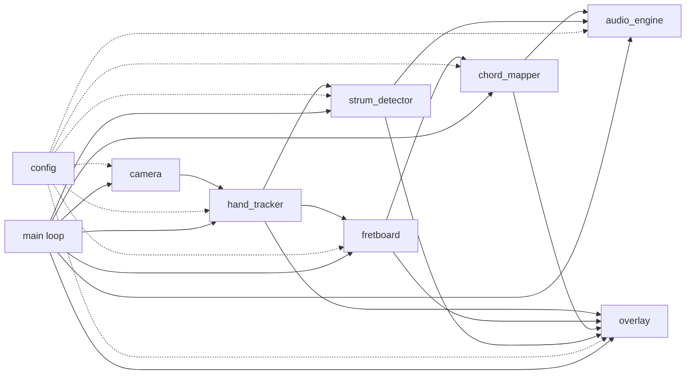
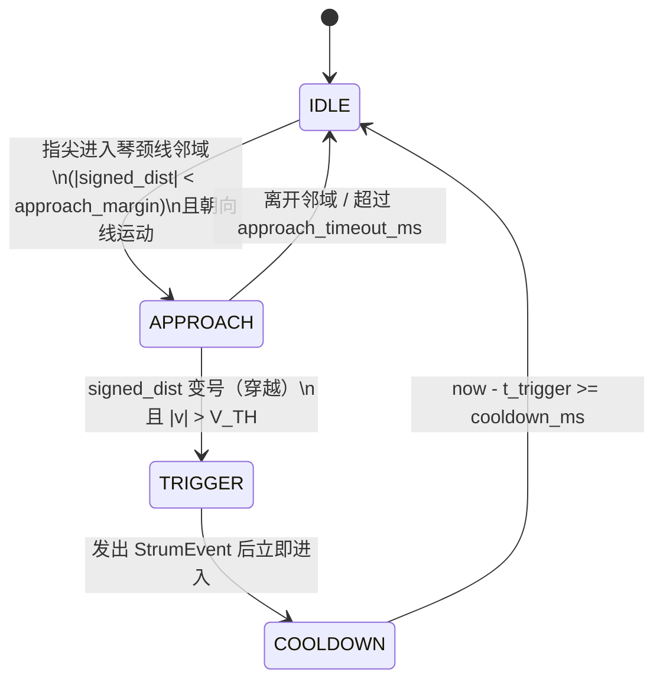

# 空气吉他交互系统 — 设计文档

> 题目：基于手部关键点的空气吉他交互系统（本科课设，CV / HCI）
> 英文：Air Guitar Interaction System Based on Hand Landmark Detection
> 性质：**设计文档 + 空代码骨架**。本文给出模块、接口、状态机与里程碑契约，实现按 D1–D10 逐模块填充 `TODO`。

---

## 1. 目标与范围

### 1.1 一句话目标

笔记本摄像头实时识别双手 → 左手决定「弦 + 品位 / 和弦」→ 右手扫弦触发发声 → 画面叠加虚拟 6 弦琴颈与 HUD，形成可演示的闭环空气吉他 Demo。

### 1.2 功能范围（MoSCoW）

**Must（验收必过）**

1. 实时摄像头预览（≥15 FPS 可用，目标 ≥20 FPS）
2. MediaPipe Hands 双手检测与关键点绘制
3. 虚拟琴颈：固定 ROI 定义 6 弦 × N 品位网格（N=4）
4. 左手指尖落入网格 → 输出 `(string_id, fret_id)` 或映射为预定义和弦
5. 右手扫弦检测（穿线 + 速度阈值）→ 触发一次发声
6. 发声：6 根空弦音 + 若干和弦（`pygame.mixer`）
7. HUD：弦名 / 当前和弦名 / 扫弦提示
8. `q` / `Esc` 退出；`d` 开关调试叠加层

**Should（报告加分）**

1. 时序滤波：连续 K 帧一致才切换和弦（多数投票）
2. 扫弦力度 → 音量
3. 单音模式 / 和弦模式切换（`m`）
4. 简单评测：日志统计误触发

**Could（时间够再做）**

1. 简谱 / 和弦进行跟练
2. 录制回放（关键点序列 + 音频时间戳）
3. 鸿蒙 / 手机推流作摄像头源（单独里程碑）

### 1.3 Out of Scope（明确不做）

- 不训练 / 不微调自定义手部检测模型（只用 MediaPipe 现成 Hand Landmarker）
- 不做真实吉他琴颈 / 品格视觉识别（ArUco 真琴方案列为未来工作）
- 不做完整调音教学 App、账号、云端、社交分享
- 第一期不做手机 App / Electron / Web 前端（鸿蒙推流仅 Could）
- 本仓库当前不包含可运行的完整算法实现，只交付骨架与接口

---

## 2. 模块总览（Mermaid）



数据主路径（单帧）：

```
Frame → Hands → Landmarks
              ├→ Fretboard.geometry → (string, fret) / chord_id
              ├→ StrumDetector → strum_event?
              └→ Overlay 绘制
                        ↓
              AudioEngine.note_on / chord_on（仅当 strum_event）
```

---

## 3. 模块职责表

| 模块 | 文件 | 职责 | 不负责 |
|---|---|---|---|
| `camera` | `src/camera.py` | 打开摄像头、设分辨率/FPS、读帧、释放 | 检测、绘制 |
| `hand_tracker` | `src/hand_tracker.py` | MediaPipe Hands 封装；输出左右手 21 点 + 可见性 | 琴颈几何、音频 |
| `fretboard` | `src/fretboard.py` | 琴颈 ROI 几何；6×N 网格；点→(s,f)；扫弦参考线 | 和弦命名、扫弦状态机 |
| `chord_mapper` | `src/chord_mapper.py` | 指型向量 ↔ 模板最近邻；单音/和弦模式；帧滤波 | 发声、穿线检测 |
| `strum_detector` | `src/strum_detector.py` | 右手指尖相对琴颈线的状态机；冷却；力度 | 选和弦、播音频 |
| `audio_engine` | `src/audio_engine.py` | 加载音色/MIDI；`note_on`/`chord_on`/`all_notes_off` | 视觉逻辑 |
| `overlay` | `src/overlay.py` | 画网格、骨架、HUD、调试层 | 业务决策 |
| `config` | `src/config.py` | 阈值、网格、和弦模板、快捷键常量 | 运行时副作用 |
| `main` | `main.py` | 组装模块；主循环；按键；退出 | 算法细节 |

---

## 4. 公共 API（与骨架一致）

```python
# --- camera.py ---
class Camera:
    def __init__(self, device_id: int, width: int, height: int, fps: int) -> None: ...
    def read(self) -> tuple[bool, Optional[np.ndarray]]: ...
    def release(self) -> None: ...

# --- hand_tracker.py ---
@dataclass
class HandResult:
    handedness: str                                # "Left" | "Right"
    landmarks: list[tuple[float, float, float]]    # 21 x (x,y,z)，约定像素坐标
    score: float

class HandTracker:
    def __init__(self, max_num_hands: int = 2, model_complexity: int = 0) -> None: ...
    def process(self, frame_bgr: np.ndarray) -> list[HandResult]: ...
    def close(self) -> None: ...

# --- fretboard.py ---
@dataclass
class FretboardGeom:
    origin: tuple[float, float]
    axis_u: tuple[float, float]        # 沿品位方向单位向量（横跨 6 弦）
    axis_v: tuple[float, float]        # 沿弦方向单位向量（品位递增方向）
    n_strings: int                     # = 6
    n_frets: int                       # = 4
    string_spacing: float
    fret_spacing: float

class Fretboard:
    def __init__(self, mode: str = "fixed_roi") -> None: ...
    def update(self, hands: list[HandResult], frame_shape: tuple[int, int]) -> FretboardGeom: ...
    def point_to_cell(self, xy: tuple[float, float], geom: FretboardGeom) -> Optional[tuple[int, int]]: ...
    def neck_line(self, geom: FretboardGeom) -> tuple[tuple[float, float], tuple[float, float]]: ...
    def draw_guide(self, frame: np.ndarray, geom: FretboardGeom) -> None: ...

# --- chord_mapper.py ---
class ChordMapper:
    def __init__(self, templates: dict[str, FingerShape], vote_window: int = 5) -> None: ...
    def fingertips_to_shape(self, left_hand: HandResult, geom: FretboardGeom,
                            fretboard: Fretboard) -> FingerShape: ...
    def match(self, shape: FingerShape) -> tuple[Optional[str], float]: ...
    def update_filtered(self, chord: Optional[str]) -> Optional[str]: ...
    def cells_to_notes(self, cells: list[tuple[int, int]], mode: str) -> list[int]: ...

# --- strum_detector.py ---
class StrumState(Enum):
    IDLE = "IDLE"; APPROACH = "APPROACH"; TRIGGER = "TRIGGER"; COOLDOWN = "COOLDOWN"

@dataclass
class StrumEvent:
    direction: str          # "down" | "up"
    velocity: float
    timestamp_ms: int

class StrumDetector:
    def __init__(self, v_th: float, cooldown_ms: int, approach_margin: float) -> None: ...
    def update(self, tip_xy, tip_vel, neck_line, now_ms: int) -> Optional[StrumEvent]: ...
    @property
    def state(self) -> StrumState: ...

# --- audio_engine.py ---
class AudioEngine:
    def __init__(self, backend: str = "pygame", asset_dir: str = "assets") -> None: ...
    def note_on(self, midi_note: int, velocity: float = 0.8) -> None: ...
    def chord_on(self, midi_notes: list[int], velocity: float = 0.8) -> None: ...
    def all_notes_off(self) -> None: ...
    def close(self) -> None: ...

# --- overlay.py ---
class Overlay:
    def draw(self, frame, hands, geom, chord, strum_state, debug: bool) -> np.ndarray: ...
```

> 骨架中 `Optional[T]` 与 `T | None` 语义等价；所有逻辑函数体为 `raise NotImplementedError` 或 `pass  # TODO`。

---

## 5. 主循环伪代码

```
init Camera, HandTracker, Fretboard, ChordMapper, StrumDetector, AudioEngine, Overlay
mode ← "chord"          # or "single"
debug ← config.DEBUG_OVERLAY
prev_tip ← None
prev_t_ms ← None

while True:
    ok, frame ← Camera.read()
    if not ok or frame is None: break
    now ← monotonic_ms()
    dt ← max(1, now - prev_t_ms)  # 毫秒

    hands ← HandTracker.process(frame)
    left  ← pick_hand(hands, "Left")
    right ← pick_hand(hands, "Right")

    geom ← Fretboard.update(hands, (H, W))
    neck ← Fretboard.neck_line(geom)

    # --- 左手：和弦 / 品位 ---
    stable_chord ← None
    active_notes ← []
    if left is not None:
        shape ← ChordMapper.fingertips_to_shape(left, geom, Fretboard)
        raw_chord, conf ← ChordMapper.match(shape)
        stable_chord ← ChordMapper.update_filtered(raw_chord)
        active_notes ← ChordMapper.cells_to_notes(shape.as_cells(), mode)

    # --- 右手：扫弦 ---
    tip ← index_fingertip(right)
    vel ← (tip - prev_tip) / dt  如果 tip 与 prev_tip 均非空
    event ← StrumDetector.update(tip, vel, neck, now)
    prev_tip ← tip; prev_t_ms ← now

    # --- 发声 ---
    if event is not None and active_notes:
        vol ← map_velocity(event.velocity)     # Should：力度→音量
        if mode == "chord": AudioEngine.chord_on(active_notes, vol)
        else: for n in active_notes: AudioEngine.note_on(n, vol)

    frame ← Overlay.draw(frame, hands, geom, stable_chord, StrumDetector.state, debug)
    imshow("AirGuitar", frame)

    key ← waitKey(1)
    if key in (q, Esc): break
    if key == 'd': debug ← not debug
    if key == 'm': mode ← toggle(mode)
    if key == 's': AudioEngine.all_notes_off()

release all
```

---

## 6. 扫弦状态机

### 6.1 状态图



### 6.2 转移表（实现时必须可测）

| 当前 | 事件 / 条件 | 下一状态 | 副作用 |
|---|---|---|---|
| IDLE | `signed_dist(tip, neck)` 进入 `(-m, +m)` 且 `dot(v, normal)` 朝向线 | APPROACH | 记录 `side0 = sign(dist)` |
| APPROACH | `sign(dist) != side0`（穿越）且 `\|v\| > V_TH` | TRIGGER | 构造 `StrumEvent(direction, velocity, now)` |
| APPROACH | 离开邻域或停留 > `approach_timeout_ms` | IDLE | 清除 `side0` |
| TRIGGER | （瞬时） | COOLDOWN | 上层发声；记 `t_trigger` |
| COOLDOWN | `now - t_trigger >= cooldown_ms` | IDLE | 允许再次触发 |

设计要点：

- **穿线**：用相对琴颈线的**有符号距离变号**，而不是单纯 y 阈值，适配倾斜琴颈。
- **速度阈值 `V_TH`**：禁止「贴线微抖」触发。
- **冷却 `COOLDOWN_MS`**（建议 80–150 ms）：一次物理扫弦只响一次。
- **方向**：`down` / `up` 由穿越符号决定，可映射力度或音色（Should/Could）。
- **调试**：Overlay 画 tip 轨迹与当前状态文字，便于标定。

---

## 7. 和弦模板方案（Am C D Em G F）

### 7.1 指型表示

对左手四指（食、中、无、小），每指一个离散 cell：

```
FingerShape = {
  index:  (string_id, fret_id) | MUTE,
  middle: (string_id, fret_id) | MUTE,
  ring:   (string_id, fret_id) | MUTE,
  pinky:  (string_id, fret_id) | MUTE,
}
```

- `string_id`：0=最粗弦(E2) … 5=最细弦(E4)
- `fret_id`：0=空弦品位区，1..N=按品格
- `MUTE`（`None`）：该指未落入任何 cell 或置信过低

匹配：shape 编码为定长向量，与模板做**汉明距离 / 加权 L1**，取最小且低于 `MATCH_MAX_DIST` 者。滤波：长度 `VOTE_WINDOW`（默认 5）滑动多数投票，可选滞回。

### 7.2 最低模板集（课设简化指型，非严格原版指法）

| 和弦 | 简化指型 `(string, fret)` | 发声音符（MIDI） |
|---|---|---|
| Am | 食(1,1) 中(2,2) 无(3,2) | A2 C3 E3 = 45 48 52 |
| C  | 食(1,1) 中(3,2) 无(4,3) | C3 E3 G3 = 48 52 55 |
| D  | 食(3,2) 中(1,2) 无(2,3) | D3 F#3 A3 = 50 54 57 |
| Em | 中(4,2) 无(3,2) | E2 B2 E3 = 40 47 52 |
| G  | 食(4,2) 中(5,3) 无(0,3) | G2 B2 D3 = 43 47 50 |
| F  | 食(1,1) 中(2,2) 无(3,3) 小(4,3) | F2 A2 C3 = 41 45 48 |

空弦定弦（`OPEN_STRING_MIDI`）：E2=40, A2=45, D3=50, G3=55, B3=59, E4=64。

### 7.3 单音模式

不走模板；把当前落入网格的指尖 cells 直接映射为 MIDI（`OPEN_STRING_MIDI[s] + fret`），扫弦时触发这些音。

---

## 8. 数据流

### 8.1 单帧数据流

```
BGR Frame
  → HandTracker → List[HandResult]
  → Fretboard.update → FretboardGeom + neck_line
  → ChordMapper（左手）→ FingerShape → raw ChordId → filtered ChordId + midi_notes
  → StrumDetector（右手 tip + vel + neck）→ Optional[StrumEvent]
  → if StrumEvent: AudioEngine.*(midi_notes, velocity)
  → Overlay → Display
```

### 8.2 config 旋钮与建议默认值

| 键 | 建议默认 | 作用 |
|---|---|---|
| `CAMERA_ID` | 0 | 设备号 |
| `FRAME_WIDTH/HEIGHT` | 640 / 480 | 降分辨率保帧率 |
| `TARGET_FPS` | 30 | 采集目标 |
| `MP_MODEL_COMPLEXITY` | 0 (lite) | 速度优先 |
| `MP_MAX_HANDS` | 2 | 双手 |
| `FRETBOARD_MODE` | `"fixed_roi"` | 或 `"wrist_axis"`（进阶） |
| `ROI_XYWH` | (140, 60, 360, 360) | 640×480 中部矩形 |
| `N_STRINGS` | 6 | 固定 |
| `N_FRETS` | 4 | 降难度 |
| `V_TH` | 需标定 | 扫弦最小速度 |
| `COOLDOWN_MS` | 100 | 防连响（80–150） |
| `APPROACH_MARGIN` | 需标定 | 邻域半宽（像素） |
| `APPROACH_TIMEOUT_MS` | 400 | 邻域内未穿越退回 IDLE |
| `VOTE_WINDOW` | 5 | 和弦多数投票 |
| `MATCH_MAX_DIST` | 需标定 | 模板匹配上限 |
| `AUDIO_BACKEND` | `"pygame"` | 或 mido/fluidsynth |
| `DEBUG_OVERLAY` | True | 启动时调试层 |
| `KEYS` | q/Esc/d/m/s | 退出/调试/模式/静音 |

标定顺序：先 `ROI` 与网格可见 → 再 `V_TH`/`COOLDOWN_MS` → 最后模板距离与 `VOTE_WINDOW`。

---

## 9. 风险与对策

| 风险 | 对策 |
|---|---|
| 关键点抖动 → 和弦乱跳 | 多数投票 + 切换滞回；降低 `N_FRETS` |
| 扫弦连响 / 不响 | 调 `V_TH` 与 `COOLDOWN_MS`；画 tip 轨迹调试 |
| 帧率低 | 640×480；`model_complexity=0`；少做重绘制 |
| 无吉他乐理基础 | 只用预置 6 和弦表；报告附指型图 |
| 光照 / 背景杂乱 | README 要求正面光、尽量纯色背景 |
| 左右手混淆 | 以 MediaPipe handedness 为准；可加镜像自拍开关 |
| 单目无深度 | 接受 2D 近似；报告「不足」章节诚实写 |
| 范围膨胀 | 严格守 Out of Scope |

---

## 10. 里程碑地图（D1–D10）

| 天 | 交付物 | Definition of Done | 主要改动文件 |
|---|---|---|---|
| D1 | 仓库骨架 + 摄像头 + 关键点画面 | 看见双手骨架 | `main.py` `camera.py` `hand_tracker.py` `requirements.txt` |
| D2 | 琴颈网格叠加 | 画面有 6×N 网格 | `fretboard.py` `overlay.py` `config.py` |
| D3 | 指尖→(s,f) | HUD/控制台显示 cell | `fretboard.py` `overlay.py` |
| D4 | 扫弦状态机 | 扫一下打 log `STRUM` | `strum_detector.py` |
| D5 | 空弦 6 音 | 扫一下有声 | `audio_engine.py` `assets/` |
| D6 | 和弦模板 | 能弹 Am/C/G 等 | `chord_mapper.py` `config.py` |
| D7 | 滤波 + 力度 | 静止不乱响、有强弱 | `chord_mapper.py` `strum_detector.py` `audio_engine.py` |
| D8 | HUD + 快捷键 | 模式切换、关调试层 | `overlay.py` `main.py` `config.py` |
| D9 | 评测与标定 | 阈值表写入文档 | `tests/` `docs/design.md` |
| D10 | Demo 视频 + README + 报告大纲 | 可交老师 | `README.md` 报告 |

Could（鸿蒙推流等）一律放 D10 之后，不影响及格。

---

## 11. 2 分钟演示脚本

1. 开程序，亮出双手骨架与虚拟琴颈（10s）
2. 左手比 Am，口播「当前和弦 Am」（10s）
3. 右手慢扫、快扫，展示力度（20s）
4. 切换单音模式扫两下（15s）
5. 关掉调试层，完整弹 Am–C–G–Em（40s）
6. 总结技术点：关键点 → 网格映射 → 状态机扫弦（15s）
